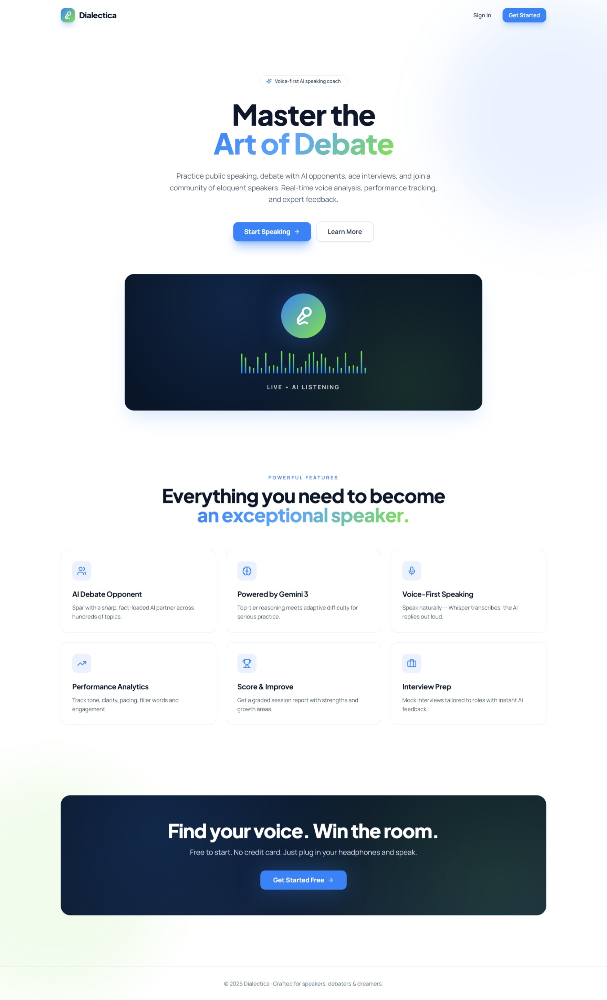
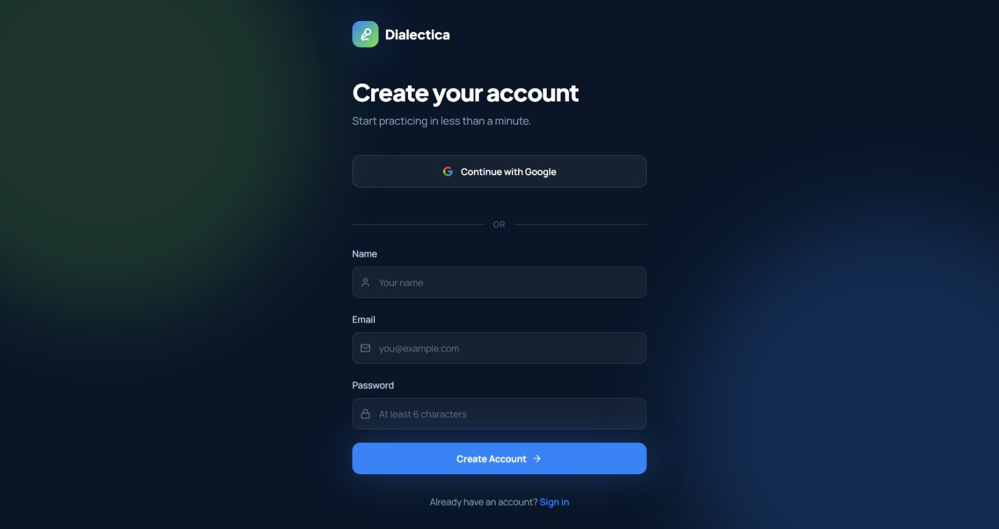
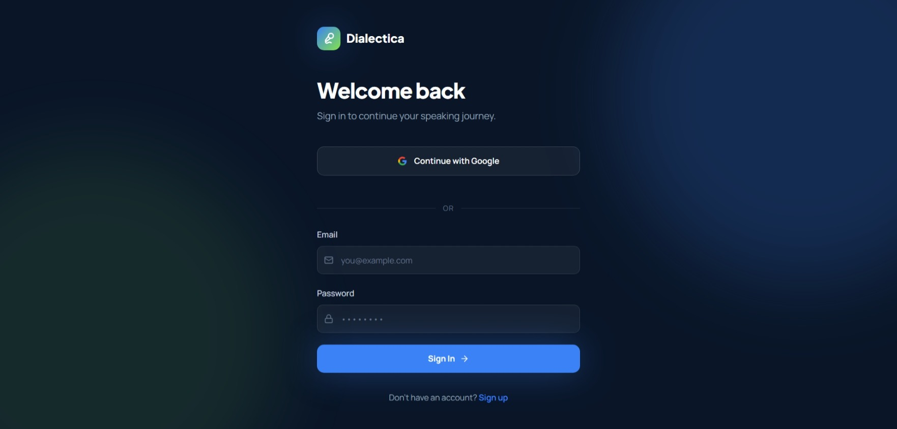
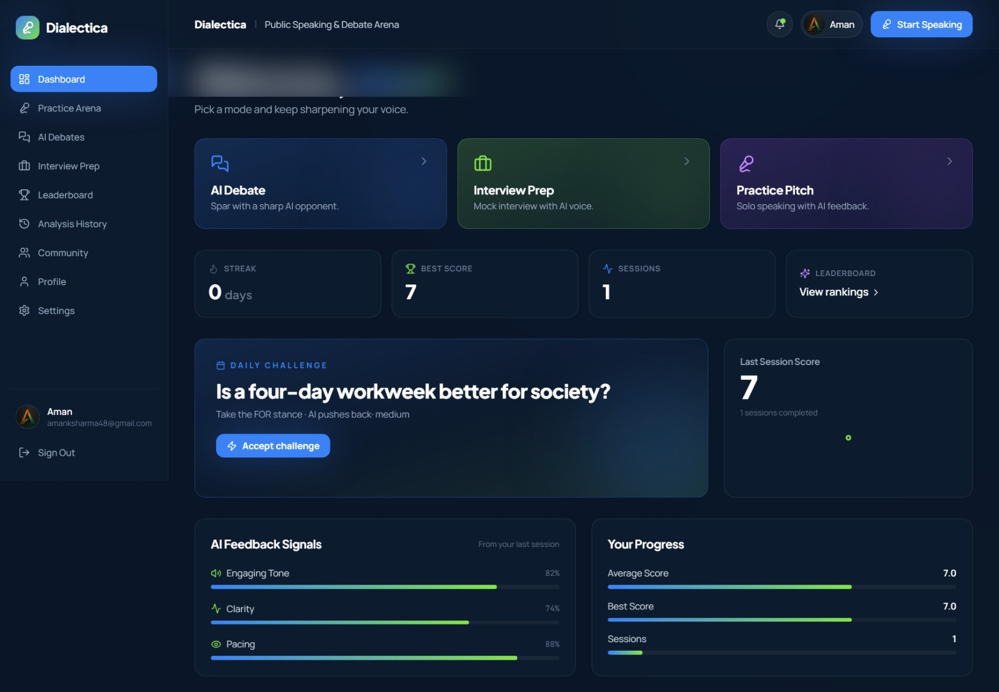
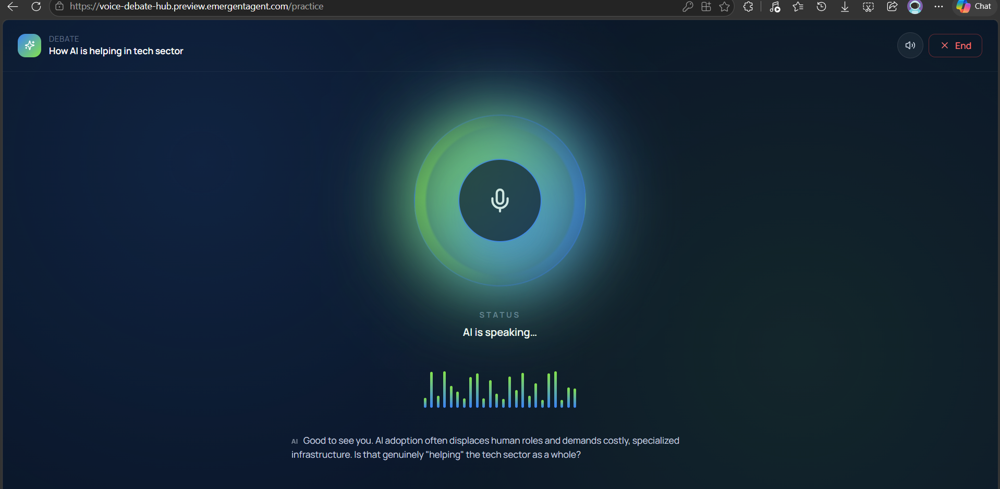
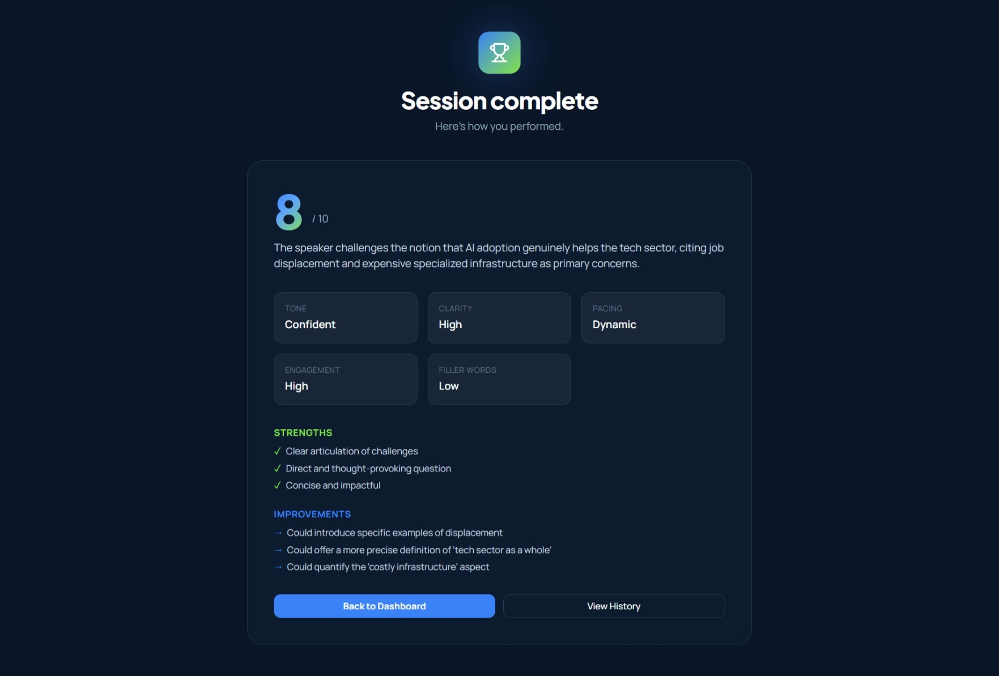

# Dialectica AI: A Debate & Interview Preparation Platform

>  
> **Author:** Aman Kumar
> 
> 
---

## 📌 Executive Summary & Architecture

Communication and active listening are fundamental professional skills that require deliberate practice and structured evaluation. **Dialectica AI** is a specialized voice-first web application designed to help users refine their public speaking, debate, and interview performance.

Unlike generic chatbots, Dialectica AI confines the conversational assistant into strict, goal-driven personas (e.g., adversarial debater, role-specific job interviewer) without interrupting the user mid-session. Once a session is completed, an asynchronous evaluation engine reviews the entire transcript and returns actionable, quantitative performance analytics.

```
┌─────────────────────────────────────────────────────────┐
│                    React 19 Frontend                    │
│   (Tailwind CSS v3, Radix UI, Recharts, MediaRecorder)  │
└────────────────────────────┬────────────────────────────┘
                             │ REST API / HTTP (MP3/JSON)
                             ▼
┌─────────────────────────────────────────────────────────┐
│                 Python FastAPI Backend                  │
│       (JWT Auth, System Prompt Builder, CORS, SSE)      │
└──────────────┬──────────────────────────┬───────────────┘
               │                          │
               ▼                          ▼
┌──────────────────────────┐  ┌──────────────────────────┐
│   MongoDB Data Store     │  │   Emergent AI Engine     │
│ (Motor Async, User/Conv) │  │(Gemini, Whisper-1, TTS-1)│
└──────────────────────────┘  └──────────────────────────┘

```

---

## ✨ Key Features

* **🎭 Configurable Practice Modes:**
* **Debate Mode:** Select a topic, take a position (*For* or *Against*), set the difficulty, and counter adversarial arguments generated in real time.
* **Interview Mode:** Define a target role (e.g., *Software Engineer*, *Product Manager*) and respond to tailored behavioral and technical questions.
* **Solo Pitch / Practice Mode:** Low-pressure environment to rehearse speeches or presentations with a supportive AI coach.


* **🎙️ End-to-End Low-Latency Voice Pipeline:** Interacts directly via browser audio (`MediaRecorder API`) through a single consolidated backend endpoint (`/api/voice/speak`) processing Speech-to-Text (Whisper-1), LLM logic (Gemini), and Text-to-Speech (TTS-1) in one round-trip.
* **📊 Quantitative Post-Session Analytics:** Structured Gemini-powered JSON evaluation calculating scores (0–100/10), analyzing tone, clarity, pacing, engagement, filler word usage, strengths, and actionable drills.
* **🏆 Gamification & Longitudinal Tracking:** Practice streak counter, personal best score records, performance area charts, daily challenge topics, and a top-50 global leaderboard.
* **🔐 Multi-Modal Authentication:** Secure access control using JWT tokens stored in `localStorage` for email/password sign-in alongside Google OAuth support using `httpOnly` cookies.

---

## 🛠️ Technology Stack

| Tier | Technologies & Tools |
| --- | --- |
| **Frontend** | React 19, Tailwind CSS v3, Radix UI (shadcn/ui pattern), Lucide React, Recharts, Sonner Toasts, Axios, CRACO |
| **Backend** | Python 3.11, FastAPI, Uvicorn (ASGI), PyJWT, Passlib / Bcrypt, Pydantic |
| **Database** | MongoDB (Async access via Motor driver v3.3.1) |
| **AI Services** | Emergent Agent SDK (`emergentintegrations`): Gemini 3.1 Pro Preview (LLM), Whisper-1 (STT), OpenAI TTS-1 (Voice Generation) |

---

## 📷 Project Output & System Screenshots

Below are key operational screens capturing the platform's execution and UI workflows:

### 1. Landing Page & Authentication
A responsive overview explaining platform capabilities, feature modes, and seamless authentication options (Email/Password or Google OAuth).

 



---

### 2. User Dashboard & Performance Tracking
Features aggregate user metrics, dynamic Recharts area charts tracking historical score evolution, streak counts, and the daily challenge banner.



---

### 3. Interactive Voice Practice Studio (VoiceSession)
Features an animated visual orb (`VoiceOrb`) representing AI state (*Idle*, *Listening*, *Thinking*, *Speaking*) alongside active speech-to-text transcript logs.



---

### 4. Post-Session Analytics & Feedback Screen
Generates radar charts, numerical scores (0–10), filler word frequency metrics, highlighted key strengths, and specific area improvement guides.



---

## ⚡ Quick Start & Installation

### Prerequisites

* **Python:** `^3.11`
* **Node.js / Yarn:** `Node v18+` & `Yarn v1.22+`
* **MongoDB:** Running locally or via MongoDB Atlas connection URI

### 1. Backend Setup

```bash
# Clone repository
git clone https://github.com/your-username/dialectica-ai.git
cd dialectica-ai/backend

# Create virtual environment
python -m venv venv
source venv/bin/activate  # On Windows: venv\Scripts\activate

# Install dependencies
pip install -r requirements.txt

# Environment configuration
cat <<EOF > .env
MONGO_URL=mongodb://localhost:27017
DB_NAME=dialectica_db
EMERGENT_LLM_KEY=your_emergent_api_key
JWT_SECRET=your_jwt_secret_key
CORS_ORIGINS=http://localhost:3000
EOF

# Start backend server
uvicorn server:app --reload --port 8000

```

### 2. Frontend Setup

```bash
# Navigate to frontend directory
cd ../frontend

# Install dependencies
yarn install

# Environment configuration
cat <<EOF > .env
REACT_APP_BACKEND_URL=http://localhost:8000
EOF

# Start React development server
yarn start

```

---

## 🧪 Testing

The platform includes end-to-end Python backend API integration tests using `pytest` that cover authentication flows, conversation management, voice processing pipeline executions, and route protection enforcing JWT security:

```bash
# Run backend test suite
cd backend
pytest tests/test_dialectia_backend.py -v

```

---
